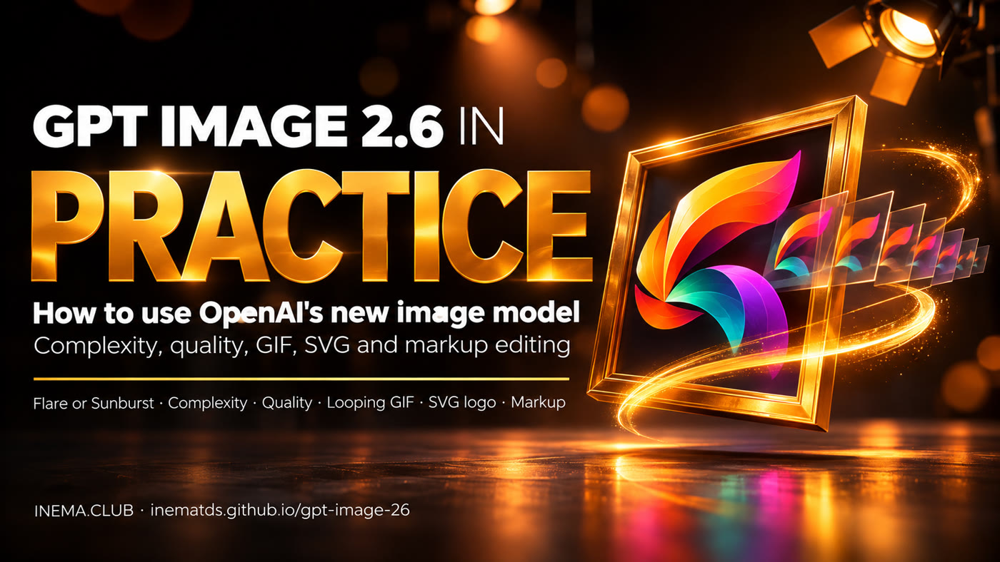

# GPT Image 2.6 in practice

[](https://inematds.github.io/gpt-image-26/guia/en/)

**🇧🇷 [Português](README.md) · 🇺🇸 [English](README.en.md) · 🇪🇸 [Español](README.es.md)**

## What it is

GPT Image 2.6 is OpenAI’s newest image model. It already runs inside ChatGPT and Codex, and can also be used through the API. This repository is a guide for anyone creating images for posts, ads, logos, stories, or videos who wants to make the most of its new features: complexity adjustment (how much the model plans before drawing), animated GIFs, vector logos (SVG), and editing only the area you mark. All you need to use it is a ChatGPT account; for the API, you’ll need an OpenAI key (billed separately from the subscription) and the `gerar.py` script, which only requires Python.

## 📖 User guide

Complete guide (landing page + step-by-step instructions): **https://inematds.github.io/gpt-image-26/guia/**

## Contents

| File | What it is |
|---|---|
| `guia/` | Guide page in PT, with `en/` and `es/` |
| `prompts.md` | 10 ready-to-use prompts: structure, complexity, sequential instructions, poster, character, saved reference, GIF, SVG, markup, and editing |
| `gerar.py` | Shortcut to the API (Python standard library only): generates an image, SVG, or GIF, or edits with markup, with `complexity` and `quality` already set; checks limits before spending |
| `exemplos/baixar.py` | Downloads the example photo and circle from OpenAI to test editing with markup |
| `tests/` | Tests for `gerar.py` without calling the API: `python3 -m unittest discover tests` |

## The process, from start to finish

| # | Step | Command | Who does it |
|---|---|---|---|
| 1 | Choose the model: Flare (fast) or Sunburst (detail) | — | 🧠 you |
| 2 | Write the request in sections (scene, subject, details, constraints, text in quotation marks) | `prompts.md` (in Portuguese) | 🧠 you |
| 3 | Preview the request without spending | `python3 gerar.py "<prompt>" --seco` | ⚙️ script |
| 4 | Generate and compare: complexity first, then quality | `python3 gerar.py "<prompt>" --complexity high --quality medium` | ⚙️ script (API, billed to your account) |
| 5 | Check hands, proportions, reflections, counts, and text | — | 🧠 you |
| 6 | Edit one thing at a time (or circle it with markup) | `python3 gerar.py "<change>" --editar exemplos/cozinha.webp --markup exemplos/circulo.png --complexity low` | ⚙️ script |

In ChatGPT, steps 3, 4, and 6 are just a conversation: ask for the image, GIF ("sprite sheet 3x3 … em loop"), or SVG.

## Quick API use

```bash
export OPENAI_API_KEY="your-key"        # Windows PowerShell: $env:OPENAI_API_KEY="sua-chave"
python3 gerar.py "Poster with the text \"SUMMER 2027\"" --modelo sunburst --quality high --seco
python3 gerar.py "Bakery logo, simple shapes" --formato svg --fundo transparente
python3 gerar.py "Cat blinks and returns to its initial pose, static camera" --formato gif --quadros 9 --ms 200
python3 exemplos/baixar.py
python3 gerar.py "Paint the vase inside the circle blue. Change nothing else. Remove the circle." --editar exemplos/cozinha.webp --markup exemplos/circulo.png --complexity low
```

An API key is created at https://platform.openai.com/api-keys and billed separately from your ChatGPT subscription.

`python3 gerar.py --help` lists all options and defaults (model `flare`, quality `medium`). Each actual request is billed to your OpenAI account.

## Cost (official calculator, 1024×1024 image)

| Quality | GPT Image 2.5 | GPT Image 2.6 |
|---|---|---|
| low | US$ 0,006 | US$ 0,025 (4,2×) |
| medium | US$ 0,013 | US$ 0,044 (3,3×) |
| high | US$ 0,053 | US$ 0,053 (equal) |
| xhigh | US$ 0,094 | US$ 0,094 (equal) |
| max | US$ 0,211 | US$ 0,211 (equal) |

## Sources

Official OpenAI documentation, consulted on 07/11/2026:
[GPT Image 2.6 prompt guide](https://developers.openai.com/api/docs/guides/image-prompting?model=gpt-image-2.6),
[image generation](https://developers.openai.com/api/docs/guides/image-generation), and
[pricing](https://developers.openai.com/api/docs/pricing).
The guide’s example images are from OpenAI documentation.

---

Made by [INEMA.CLUB](https://inema.club).