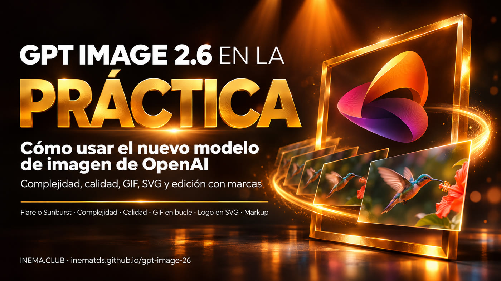

# GPT Image 2.6 en la práctica

[](https://inematds.github.io/gpt-image-26/guia/)

**🇧🇷 [Português](README.md) · 🇺🇸 [English](README.en.md) · 🇪🇸 [Español](README.es.md)**

## Qué es

GPT Image 2.6 es el modelo de imágenes más nuevo de OpenAI, que ya funciona dentro de ChatGPT y Codex y también puede usarse mediante la API. Este repositorio es una guía para quienes crean imágenes para publicaciones, anuncios, logotipos, historias o videos y quieren aprovechar las novedades: el ajuste de complejidad (cuánto planifica el modelo antes de dibujar), GIF animado, logotipo vectorial (SVG) y edición solo en el área que marcas. Para usarlo basta con una cuenta de ChatGPT; para la API, una clave de OpenAI (se cobra por separado de la suscripción) y el script `gerar.py`, que solo necesita Python.

## 📖 Guía de uso

Guía completa (landing + paso a paso): **https://inematds.github.io/gpt-image-26/guia/es/**

🎬 Video: https://www.youtube.com/watch?v=bHTe58nwW3s

## Contenido

| Archivo | Qué es |
|---|---|
| `guia/` | Página de la guía en PT, con `en/` y `es/` |
| `prompts.md` | 10 prompts listos (en portugués): estructura, complejidad, instrucciones en secuencia, cartel, personaje, referencia guardada, GIF, SVG, markup y edición |
| `gerar.py` | Acceso directo a la API (solo biblioteca estándar de Python): genera una imagen, SVG o GIF, o edita con markup, ya con `complexity` y `quality`; comprueba los límites antes de gastar |
| `exemplos/baixar.py` | Descarga la foto y el círculo de ejemplo de OpenAI para probar la edición con markup |
| `tests/` | Pruebas de `gerar.py` sin llamar a la API: `python3 -m unittest discover tests` |

## El proceso, de principio a fin

| # | Paso | Comando | Quién lo hace |
|---|---|---|---|
| 1 | Elegir el modelo: Flare (rápido) o Sunburst (detalle) | — | 🧠 tú |
| 2 | Escribir la solicitud en secciones (escena, sujeto, detalles, restricciones, texto entre comillas) | `prompts.md` | 🧠 tú |
| 3 | Revisar la solicitud sin gastar | `python3 gerar.py "<prompt>" --seco` | ⚙️ script |
| 4 | Generar y comparar: primero la complejidad, después la calidad | `python3 gerar.py "<prompt>" --complexity high --quality medium` | ⚙️ script (API, se cobra en tu cuenta) |
| 5 | Revisar manos, proporciones, reflejos, cantidad y texto | — | 🧠 tú |
| 6 | Editar una cosa por vez (o marcarla con markup) | `python3 gerar.py "<cambio>" --editar exemplos/cozinha.webp --markup exemplos/circulo.png --complexity low` | ⚙️ script |

En ChatGPT, los pasos 3, 4 y 6 son solo una conversación: pide la imagen, el GIF («sprite sheet 3x3 … en bucle») o el SVG.

## Uso rápido de la API

```bash
export OPENAI_API_KEY="tu-clave"        # Windows PowerShell: $env:OPENAI_API_KEY="tu-clave"
python3 gerar.py "Cartel con el texto VERANO 2027" --modelo sunburst --quality high --seco
python3 gerar.py "Logo de padaria, formas simples" --formato svg --fundo transparente
python3 gerar.py "Gato pisca e volta à pose inicial, câmera parada" --formato gif --quadros 9 --ms 200
python3 exemplos/baixar.py
python3 gerar.py "Pinte de azul o vaso no círculo. Não mude mais nada. Tire o círculo." --editar exemplos/cozinha.webp --markup exemplos/circulo.png --complexity low
```

La clave de la API se crea en https://platform.openai.com/api-keys y se cobra por separado de la suscripción de ChatGPT.

En Windows, usa `py` en lugar de `python3`. Sin Git, descarga el [ZIP](https://github.com/inematds/gpt-image-26/archive/refs/heads/main.zip).

`python3 gerar.py --help` muestra todas las opciones y los valores predeterminados (modelo `flare`, calidad `medium`). Cada solicitud real se cobra en tu cuenta de OpenAI.

## Costo (calculadora oficial, imagen 1024×1024)

| Calidad | GPT Image 2.5 | GPT Image 2.6 |
|---|---|---|
| low | US$ 0,006 | US$ 0,025 (4,2×) |
| medium | US$ 0,013 | US$ 0,044 (3,3×) |
| high | US$ 0,053 | US$ 0,053 (igual) |
| xhigh | US$ 0,094 | US$ 0,094 (igual) |
| max | US$ 0,211 | US$ 0,211 (igual) |

## Fuentes

Documentación oficial de OpenAI, consultada el 07/11/2026:
[guía de prompts de GPT Image 2.6](https://developers.openai.com/api/docs/guides/image-prompting?model=gpt-image-2.6),
[generación de imágenes](https://developers.openai.com/api/docs/guides/image-generation) y
[precios](https://developers.openai.com/api/docs/pricing).
Las imágenes de ejemplo de la guía son de la documentación de OpenAI.

---

Hecho por [INEMA.CLUB](https://inema.club).